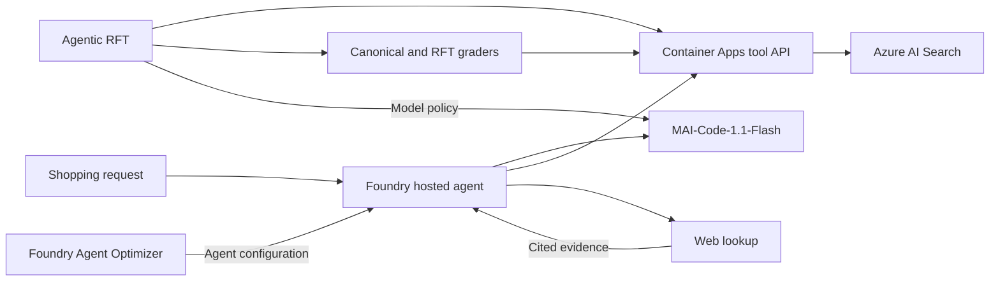

# ShoppingBench agent hill climbing on Microsoft Foundry

[](https://github.com/AliciaFrame/shoppingbench-foundry/actions/workflows/ci.yml?query=branch%3Aremediation%2Fv2-rft-hardening)

This repository is a reproducible, end-to-end demonstration of improving five
tool-using shopping agents built on **MAI-Code-1.1-Flash**, using two levers
in sequence:

1. **Agent Optimizer** rewrites instructions, skills, and tool descriptions
   without changing model weights.
2. **Reinforcement fine-tuning (RFT)** changes the weights, and is used only
   where calibration shows a learnable signal.

We demonstrate, across five scenarios, how Foundry's agent optimizer and reinforcement fine tuning can be used to achieve (or beat!) frontier performance at a fraction of the cost.

## What the benchmark tests

ShoppingBench evaluates whether an agent can search a product catalog, inspect
evidence, recommend the correct ordered product IDs, terminate cleanly, and
return a grounded answer. The five agents cover four task families, with Web
evaluated separately using model knowledge and live search:

| Agent | Agent must | Why it matters |
|---|---|---|
| **Product** | Find one item satisfying title, price, service, SKU, and attribute constraints | Precise retrieval, inspection, and constraint satisfaction |
| **Shop** | Find all requested products from the same shop | Multi-item planning and a cross-product invariant |
| **Voucher** | Apply voucher threshold, discount, shop scope, and final budget | Tool use plus arithmetic and policy constraints |
| **Web (static)** | Resolve a factual clue from model knowledge and select the matching product | Knowledge-to-action grounding without a live lookup |
| **Web (live)** | Resolve the clue with live web evidence and select the matching product | Evidence-grounded retrieval and recommendation |

The agent interacts through four catalog tools:

1. `find_product` searches the product index.
2. `view_product_information` inspects full details.
3. `recommend_product` submits ordered product IDs.
4. `terminate` explicitly closes the episode.

A fluent final answer is not enough: the agent must retrieve the right
objects, inspect evidence, preserve ordering, satisfy task-specific invariants,
and follow the recommendation/termination protocol.

## Architecture



The stateless FastAPI tool runtime reads the controlled catalog from Azure
AI Search through managed identity. Five hosted agents load task-specific
instructions, skills, and tool definitions. Web (live) first retrieves cited
evidence with a fixed lookup; only its MAI catalog-selection agent is optimized
and fine-tuned. Evaluation and RFT graders are separate from that lookup.

See [docs/architecture.md](docs/architecture.md) for the component and data-flow
details, and [docs/reproducibility.md](docs/reproducibility.md) for clean-clone
verification and the cloud rerun sequence.

## How hill climbing works

**Agent Optimizer** changes the configuration around a fixed base model:
instructions, skills, and tool descriptions/schemas. Its LLM judge proposes
candidates; the canonical deterministic grader decides which improvements to
retain.

**Agentic RFT** changes the model policy using multi-step tool episodes and a
calibrated reward. Checkpoints are evaluated rather than blindly retaining the
last artifact. Product and Shop reached their selected results without RFT;
Voucher, Web (static), and Web (live) have published RFT checkpoints.
The training reward is distinct from the canonical benchmark score used in
the result tables.

Optimizer and RFT data are group-disjoint from development and final cases.
Configuration and checkpoint selection use the 30-case development split,
with three rollouts per case. The sealed 50-case final tests are opened once
after selection, not repeatedly used to choose candidates. This is the v2
evaluation contract.

## Results

Every stage uses the same 30-case development split for its task with three
rollouts per case (90 episodes). Score is the canonical deterministic
ShoppingBench score; runtime errors count as zero. Recorded token cost is per
1,000 episodes at list price (MAI-Code-1.1-Flash: $0.20 input / $1.20 output per
1M tokens, input priced uncached).

| Agent | Stage | Score | Latency | Tokens | Cost / 1k episodes |
|---|---|---:|---:|---:|---:|
| **Product** | Base | 0.753 | 31.8s | 16,227 | $5.37 |
|  | **Agent Optimized** ✅ | **0.941** | **16.2s** | **13,948** | $5.64 |
| **Shop** | Base | 0.796 | 51.3s | 14,821 | $6.49 |
|  | **Agent Optimized** ✅ | **0.937** | **25.6s** | 33,799 | $11.98 |
| **Voucher** | Base | 0.855 | 61.7s | 20,892 | $9.44 |
|  | Agent Optimized | 0.861 | 35.2s | 30,897 | $12.08 |
|  | **RFT** ✅ | **0.925** | **23.1s** | 29,610 | **$8.90** |
| **Web (static)** | Base | 0.691 | 99.7s | 77,709 | $31.71 |
|  | **Agent Optimized** ✅ | **0.729** | 101.0s | 97,156 | $38.53 |
|  | RFT (token alternative) | 0.718 | **48.8s** | **37,278** | **$13.33** |
| **Web (live)** | Base | 0.250 | 39.2s | 24,023 | $16.79 |
|  | Agent Optimized | 0.829 | 20.0s | 25,236 | $13.19 |
|  | **RFT** ✅ | **0.903** | **19.8s** | 26,198 | **$12.56** |

✅ marks the selected configuration. Product and Shop reached their results
with Agent Optimizer alone, so RFT was not needed.

**Web (static)** offers two choices: Agent Optimized has the best score, while
its RFT checkpoint gives up 0.011 score with lower recorded token consumption
and latency. Recorded tokens and costs exclude unavailable usage from failed
episodes.

**Web (live)** climbs at both steps, and both gains are statistically clear
(paired, case-clustered 95% confidence intervals):

| Step | Score gain | 95% CI | RFT reward | Exact product |
|---|---:|---|---:|---:|
| Base → Agent Optimized | +0.579 | [+0.437, +0.711] | 0.180 → 0.739 | 21 → 74 / 90 |
| Agent Optimized → RFT | +0.073 | [+0.001, +0.165] | 0.739 → 0.820 | 74 → 81 / 90 |

RFT roughly halved the episodes that ran out of tool steps without
recommending a product (15 → 7). On the sealed 50-case final test, opened once
after selection, the RFT agent scored **0.906** with 45/50 exact products.
Web (live) cost includes the GPT-5.4-mini web-search lookup that precedes the
agent, priced at $0.75 / $4.50 per 1M tokens.

The machine-readable source for these tables is
[`evals/results/summary.json`](evals/results/summary.json), generated from the
committed per-episode receipts by
[`evals/scripts/build_release_summary.py`](evals/scripts/build_release_summary.py).
See [`docs/results.md`](docs/results.md) for interpretation.

<!-- model-cost-comparison:start -->
## Cost comparison with GPT-5.6

To understand the tradeoffs in quality and cost versus frontier mode,s we compare the published MAI-Code-1.1-Flash choices against each GPT-5.6
model's highest observed canonical score among available complete vanilla
and agent-optimized runs. We ran agent optimizer for GPT 5.6 Luna, Terra, and Sol to generate the best performing configuration for each agent. To measure quality and cost, each run uses the same 30 development cases
and 3 rollouts (90 episodes); failed episodes remain zero-scored. We measured the total token counts and used published list prices.
The two Web (static) rows show the accuracy choice and the RFT token alternative.
Each model cell shows **score / recorded token cost (USD per 1,000 episodes)**.

| MAI run | MAI Flash | Luna | Terra | Sol |
|---|---:|---:|---:|---:|
| Product&nbsp;(opt.) | **0.941&nbsp;🏆**&nbsp;/&nbsp;$5.64 | 0.841\*&nbsp;/&nbsp;**$3.21&nbsp;💰** | 0.766\*&nbsp;/&nbsp;$19.15 | 0.865\*&nbsp;/&nbsp;$47.16 |
| Shop&nbsp;(opt.) | **0.937&nbsp;🏆**&nbsp;/&nbsp;$11.98 | 0.890&nbsp;/&nbsp;**$9.06&nbsp;💰** | 0.833\*&nbsp;/&nbsp;$59.16 | 0.871&nbsp;/&nbsp;$163.19 |
| Voucher&nbsp;(RFT) | **0.925&nbsp;🏆**&nbsp;/&nbsp;**$8.90&nbsp;💰** | 0.705&nbsp;/&nbsp;$19.36 | 0.742&nbsp;/&nbsp;$185.01 | 0.781&nbsp;/&nbsp;$374.95 |
| Web&nbsp;static&nbsp;(opt.) | 0.729&nbsp;/&nbsp;$38.53 | 0.703&nbsp;/&nbsp;**$13.95&nbsp;💰** | 0.823&nbsp;/&nbsp;$91.69 | **0.868&nbsp;🏆**&nbsp;/&nbsp;$356.65 |
| Web&nbsp;static&nbsp;(RFT&nbsp;v5) | 0.718&nbsp;/&nbsp;**$13.33&nbsp;💰** | 0.703&nbsp;/&nbsp;$13.95 | 0.823&nbsp;/&nbsp;$91.69 | **0.868&nbsp;🏆**&nbsp;/&nbsp;$356.65 |
| Web&nbsp;live&nbsp;(RFT&nbsp;v6) | 0.903&nbsp;/&nbsp;$12.56 | **0.968\*&nbsp;🏆**&nbsp;/&nbsp;**$9.69&nbsp;💰** | 0.946\*&nbsp;/&nbsp;$30.96 | 0.941\*&nbsp;/&nbsp;$55.61 |

**🏆** marks the highest measured score in each row (not a claim of
statistical significance).

**💰** marks the lowest recorded token cost
among that row's runs. 

**\*** marks a selected agent-optimized GPT run; unmarked GPT
results are vanilla. These GPT runs use the MAI-tuned configuration, not
independent GPT-specific tuning. Selection is among available complete runs,
not every possible optimized configuration.

MAI RFT checkpoints are Voucher step 10, Web (static) v5 final, and Web (live) v6 final.
Excluded incomplete candidates: Luna Voucher optimized (47/90); Terra Web (static) optimized (85/90).

Recorded token costs are **USD per 1,000 episodes**, calculated from API-reported
input and output tokens, including reasoning output, with all input priced
uncached. Rates per 1M tokens (input / output):
MAI $0.20 / $1.20;
Luna $0.20 / $1.20;
Terra $2.00 / $12.00;
Sol $4.00 / $20.00.
Web (live) also includes the GPT-5.4-mini lookup at
$0.75 / $4.50.
Training, hosting, and any separately billed search/tool fees are excluded.

Costs exclude unavailable token usage from failed episodes.

Recalculate the table offline, without Azure credentials or inference:

```powershell
python evals\scripts\compare_model_costs.py --write-readme
python evals\scripts\compare_model_costs.py --check
```

The [manifest](evals/results/model-comparison/manifest.json) contains prices,
all eligible stage inputs, excluded-run counts, and SHA-256 provenance.
Receipt and dataset hashes normalize CRLF to LF for cross-platform checks.
Committed GPT receipts retain per-episode scores, token usage, and failure
flags; MAI runs reference the existing full receipts. The
[generated summary](evals/results/model-comparison/summary.json) includes
every candidate's score, total tokens, failure count, and missing-usage count.
This reproduces the arithmetic and stage selection, not a new inference run.
<!-- model-cost-comparison:end -->

## Repository map

See [CHANGELOG.md](CHANGELOG.md) for v1/v2 workflow differences and release notes.

| Directory | Purpose |
|---|---|
| [`agents`](agents) | Runnable baseline and optimized agents for all five tasks |
| [`data`](data) | Frozen ShoppingBench rows and deterministic catalog generation |
| [`evals`](evals) | Datasets, evaluation and scoring scripts, receipts, comparisons, and release summary |
| [`optimize`](optimize) | Agent Optimizer runner and reproducible seed configurations |
| [`rft`](rft) | RFT data preparation, calibration, submission, and job receipts |
| [`src/shoppingbench_foundry`](src/shoppingbench_foundry) | Tool API, canonical grader, RFT graders, and catalog store |
| [`azure`](azure) | Azure deployment for the catalog, tool API, and RFT grader endpoints |
| [`docs`](docs/README.md) | Architecture, results, reproducibility, and demo walkthrough |

## Companion skill: MAI-agent-hillclimb

The standalone [MAI-agent-hillclimb skill](.github/skills/mai-agent-hillclimb/SKILL.md)
guides hosted-agent setup, baseline evaluation, Agent Optimizer, justified RFT,
and checkpoint selection/verification for any use case. ShoppingBench is an
optional worked example, not a required runtime or evaluator.

The skill bundles a runnable hosted-agent starter, grader/evaluator and tool
endpoints, isolated dataset/evaluation helpers, calibrated optimizer and RFT
commands, sealed selection, and a standard-library cost calculator with
Azure-first/GitHub-fallback pricing guidance. Follow its
Matched reports compare quality, latency, serving savings, cost per successful
task, and experiment investment/break-even without treating unknown costs as zero. Follow its
[executable runbook](.github/skills/mai-agent-hillclimb/references/runbook.md).
It does not require another Foundry skill to be loaded. Clone this
repository to use its project skill, or copy the entire skill directory into
a supported project/personal skills location.

Run its deliberately synthetic offline cost example:

```powershell
python .github\skills\mai-agent-hillclimb\scripts\cost_report.py `
  --receipts .github\skills\mai-agent-hillclimb\examples\episodes.synthetic.jsonl `
  --prices .github\skills\mai-agent-hillclimb\examples\prices.synthetic.json
```

## Reproduce

Deterministic artifacts, tests, and the release tables reproduce locally:

```powershell
git clone --branch remediation/v2-rft-hardening https://github.com/AliciaFrame/shoppingbench-foundry.git
Set-Location shoppingbench-foundry
python -m venv .venv
.\.venv\Scripts\python -m pip install -e ".[agents,dev]"
.\.venv\Scripts\python data\scripts\prepare.py
.\.venv\Scripts\python rft\scripts\prepare_data.py
.\.venv\Scripts\python evals\scripts\build_release_summary.py
.\.venv\Scripts\python evals\scripts\compare_model_costs.py --check
.\.venv\Scripts\python -m pytest
.\.venv\Scripts\python -m ruff check .
```

The frozen source contains 900 public cases. The controlled search corpus has
1,818 benchmark gold products plus one deterministic distractor per product
(3,636 documents). It supports reproducible behavior comparisons; it is not
equivalent to the original production-scale ShoppingBench catalog.

Use [`.env.example`](.env.example) as the configuration reference and set the
needed variables in your shell or active `azd` environment. Prefer managed
identity or `DefaultAzureCredential` where supported; never commit keys or
bearer tokens.

Rerunning the agents requires a MAI-Code-1.1-Flash deployment, the deployed
ShoppingBench tool API, and the environment variables in
[`.env.example`](.env.example). [`docs/reproducibility.md`](docs/reproducibility.md)
gives the exact commands for every row above: base and optimized evaluation,
Agent Optimizer, RFT calibration and submission, checkpoint evaluation, and
scoring.

For a cloud rerun, a Microsoft Foundry project and accessible model deployments
are prerequisites; the Bicep data-plane template does not create them implicitly.

1. Provision the Azure tool runtime and load the search corpus using
   [azure/README.md](azure/README.md). The indexing identity needs
   `Search Index Data Contributor`; the runtime uses `Search Index Data Reader`.
2. Configure the project, model, and tool endpoints and deploy the five hosted
   agents using [agents/README.md](agents/README.md).
3. Evaluate with [evals/README.md](evals/README.md), optimize with
   [optimize/README.md](optimize/README.md), and calibrate/train with
   [rft/README.md](rft/README.md). Web (live) also needs its fixed lookup and
   semantic-judge deployments.

RFT is optional, access-dependent, and billable. Job receipts under
[`rft/jobs`](rft/jobs/README.md) record the original runs; their IDs are
evidence and must not be reused as configuration.

## Presenting the demo

Use [docs/demo-walkthrough.md](docs/demo-walkthrough.md) to start with a task,
run a tool episode, explain the grader, show optimization evidence, and finish
with the RFT result. The standalone
[HTML slide deck](docs/shoppingbench-hill-climb-deck.html) and editable
[16:9 summary slide](docs/shoppingbench-hill-climb-summary-slide.html) support
presentations and browser PDF export.

## Attribution

This project adapts [ShoppingBench](https://github.com/yjwjy/ShoppingBench)
under the Apache License 2.0. See [NOTICE](NOTICE).
